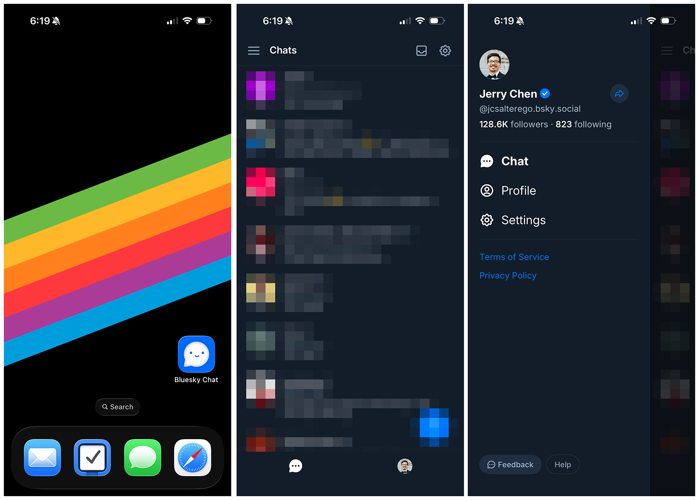

# Bluesky Chat

This repository is a fork of [`bluesky-social/social-app`](https://github.com/bluesky-social/social-app) focused on the Chat experience.

# Screenshots

## About This Fork

Bluesky Chat keeps the upstream Bluesky social app foundation while narrowing development around direct messaging and chat-centered workflows. The original upstream project is a React Native and TypeScript application for web, iOS, and Android built on AT Protocol packages such as `@atproto/api`.

## Attribution

This fork is based on Bluesky Social App by Bluesky Social PBC. Upstream source and project history remain available at <https://github.com/bluesky-social/social-app>.

## License

This project retains the upstream MIT license. See [LICENSE](./LICENSE).
